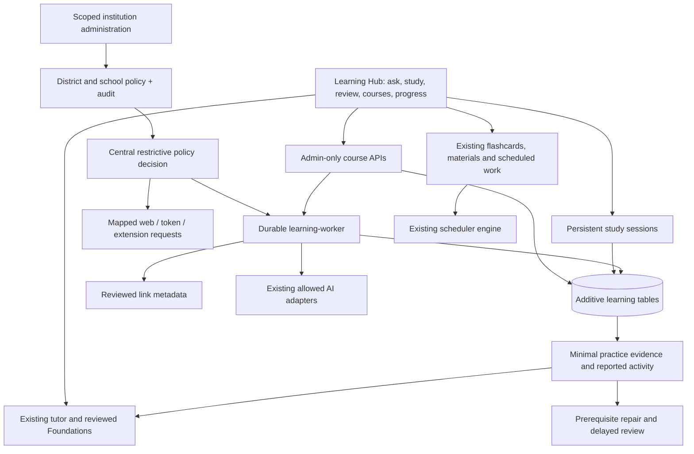

# Consolidated architecture

The new hub reuses the existing `/api/tutor` and links to reviewed Foundations, active scheduled blocks, study materials and flashcards. It does not replace existing curriculum or discard learning history.

Authentication follows the real endpoint: cookie-only web handlers use the signed-in cookie; `/api/v1` uses its credential resolver; Focus Shield uses its own token-first resolver; older extension routes use their extension header. An unrelated Authorization header cannot replace the web user's institution policy.

District and school memberships form a restrictive intersection. Boolean capabilities AND together, assessment protection ORs together, token ceilings take the minimum, and provider lists intersect. Scoped administrators may manage their school, or child schools if they administer the district. Platform administrators provision organizations and administrative roles. User/subscription choices cannot grant a denied capability. Existing explicit AI-personalization consent controls whether new learning evidence enters tutor context.

Course jobs process one lesson per bounded CLI step. A conditional lease claim excludes competing workers, expired leases can be reclaimed, and final conditional updates ensure cancellation or lease replacement wins. Owner eligibility and allowed providers are rechecked before saving output. DB uniqueness protects course lesson keys and single-item evidence. Study sessions use an open-session unique index and optimistic revisions; stale updates return409.

The evidence adapter stores objective, kind, correctness, assistance and timestamp. Self-reports have `correct=null`; elapsed time never creates correctness. Builders have answer-key access, so course checks are always assisted. Existing reviewed tutor/Primer data remains authoritative. New evidence is a minimal connection, not a single normalized cross-platform knowledge graph. Scheduler-linked task adaptation, longitudinal skill validation and shared course/tutor evidence IDs remain incomplete.

Schema setup uses the existing boot-time schema lock and additive table registration. No production migration, data restore, rollback rehearsal or deployed worker has been performed. Route-prefix policy coverage and anonymous legacy demos require further review before a managed school pilot.
