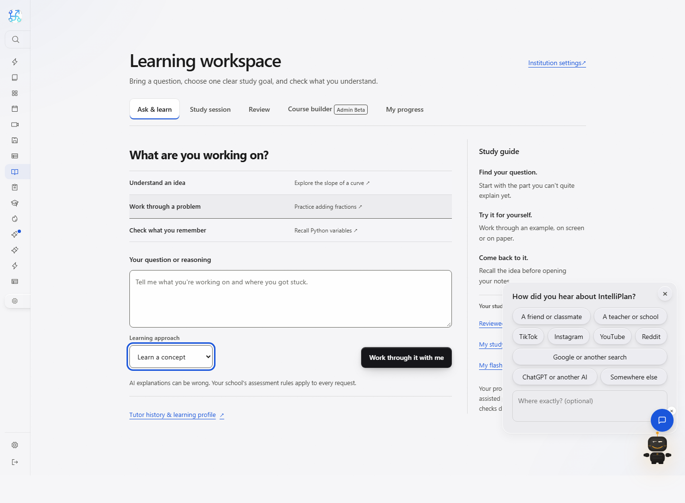
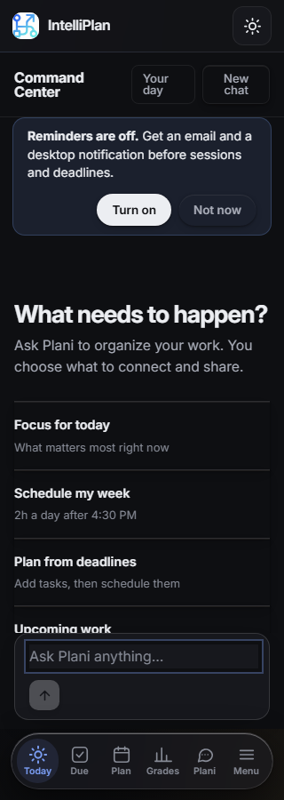

# Learning workspace and Command Center UI — 2026-10-12

The latest user instruction adds continued UI adaptation alongside the original engineering work and requires a commit/push at every major checkpoint. This slice refines two working app surfaces while preserving their existing behavior and theme tokens. References inspected: https://cluely.com and https://www.skydive.com. Their product claims are not adopted by IntelliPlan.

The Learning Hub has a direct workspace title, less decorative introductory copy, flat working sections, row-based starters and a quieter study guide. Its form labels, activity switches, native controls, privacy disclosures and beta notices remain. The Command Center has row-based starters; their descriptions stack under the actions on phones. Its copy describes the student's choice of connections/sharing instead of implying unconditional access to all account data. The shared shell and other product surfaces still need broader design work.

Chromium verification completed 18 Learning Hub workflows, 29 responsive/layout checks and 29 scoped axe-core 4.10.3 checks, with zero JavaScript errors. The existing browser executable override was used because the default SDK-matched browser was absent. Updated title assertions match the new title. Wider lesson space now fits some short code examples; the keyboard-scroll assertion conditionally constrains an actual rendered code region to 120px. This proves keyboard scrolling in that deliberately constrained fixture, rather than natural overflow of those short snippets.

The committed `scripts/verify_command_center_ui.py` configures its own synthetic temporary SQLite database, disables unrelated timers, records synthetic policy acknowledgements and visits the real signed-in route. Six light/dark checks at 320, 768 and 1440px passed, with no scoped axe violations, page overflow or JavaScript errors. It selects essential-only cookies for the screenshots. Engine/session/server resources are closed before temporary cleanup. The first helper run completed its visual assertions but failed cleanup because the SQLite connection stayed open; it is not counted as an exit-zero run. The corrected runner passed. Source review also required output-directory creation and cleanup independent of report writing; those corrections passed re-review.

Focused Learning Hub tests: 145 passed, 1541 warnings in 19.21s. The preceding integrated workspace had 322 focused passing checks. Hosted CI for integration commit 19c480b passed the complete default suite (4408 passed, 16 skipped), followed by 130 passing live smoke checks (1 skipped) against the already deployed website. Those smoke checks do not verify deployment of this branch or its database changes. Hosted tests/security checks passed; an unrelated Cloudflare Workers build check failed. This application uses Railway, and this report does not describe the failed Workers check as a production Railway deployment.

Scoped CSS/template review reported no actionable findings. The verification helper's cleanup finding was fixed and independently re-reviewed. Source fingerprints and browser results are refreshed at this checkpoint. Screenshots below are local previews; the live website has not been changed by this branch push. Broader UI, manual screen-reader coverage, localization, live vendor workflows and the original master brief remain incomplete.

